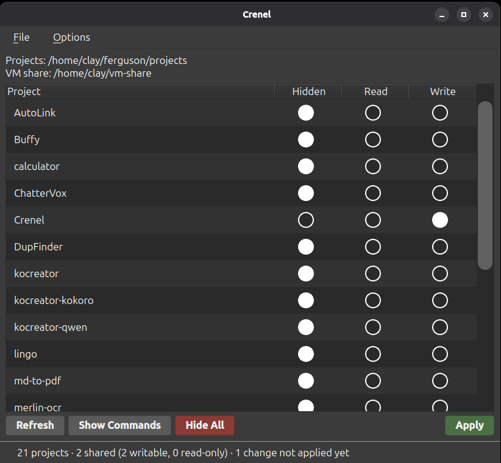

# Crenel

  

A desktop utility for rapidly and easily configuring folder shares in a QEMU/KVM virtual machine. It controls which of your project folders the VM can see, one project at a time. Each project is **Hidden**, **Read** or **Write**: pick with the radio buttons, press **Apply**, and enter your password once. 



With Crenel, well you can specify one single shared folder with all your projects in it, that you share to the Guest/VM, so that you only have to set up the VM to point to that one folder. Then depending on which project you want your VM to be able to see at any given time, you simply choose the proper radio buttons in the Crenel app. This allows you to only give your VM access to the exact folders that it needs to have at any given time, thereby reducing the risk of any rogue agents altering any files without your knowledge. 

This application was created primarily for the use case of AI Agents running in the VM, and it allows you to be sure that the agent is only able to edit files in the project that you're currently working on.

**Highlights**

- The VM shares one folder; Crenel bind-mounts only the projects you choose into it. Nothing is copied, and edits land in your real project.
- Read-only is enforced by the host kernel. Nothing in the VM, root included, can write through it.
- Optional git protection: `.git/hooks` and `.git/config` stay read-only in writable projects, so an agent cannot plant a hook that runs on your host.
- Everything is hidden again after a reboot.
- **Show Commands** previews exactly what Apply will do. Crenel runs as you, and only a small, strict helper runs as root through `pkexec`.

## Documentation

📖 **[User Guide](docs/USER_GUIDE.md)**: the one-time VM setup, every control, git protection, folders in use, and what Crenel does not protect. Also readable in the app under **Options ▸ User Guide**.

⚙️ **[Configuration reference](docs/CONFIG.md)**: the YAML file behind the settings dialog.

🛠 **[AGENTS.md](AGENTS.md)**: architecture and implementation notes.

## Requirements

Linux with `pkexec`, and a VM sharing a host folder over virtiofs (libvirt/virt-manager, for example).

Running from this checkout needs `uv` (see [uv's install page](https://docs.astral.sh/uv/)); it pulls in PyQt6 and PyYAML on first run. The `.deb` uses the distribution's `python3-pyqt6` and `python3-yaml` instead.

The wide scroll bars, radio buttons, check boxes and help window come from **[windowchrome](https://github.com/Clay-Ferguson/windowchrome)**, which is not on PyPI and must be checked out beside this folder:

```bash
cd ..
git clone https://github.com/Clay-Ferguson/windowchrome.git
```

## Running

```bash
./start.sh
```

On the first run the settings dialog opens: choose your projects folder and the share folder. Then follow [One-time VM setup](docs/USER_GUIDE.md#one-time-vm-setup) to point the VM at the share folder.

## Installing

```bash
./build.sh
```

This builds `dist/crenel_<version>_all.deb` and offers to install it. The package adds a menu entry, the root helper at `/usr/lib/crenel/crenel-helper`, and a polkit action, so the password prompt names Crenel and is remembered for a few minutes.

## Development

```bash
./tests/run.sh   # the test suite, including real bind mounts in a throwaway namespace
./lint.sh        # ruff, pyright, bash -n
```
